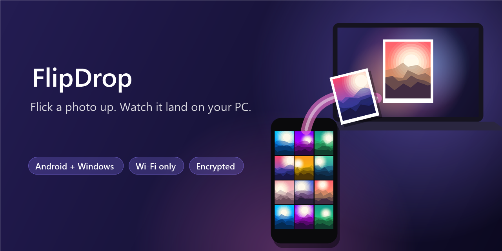

<p align="center">
  
</p>

<h1 align="center">FlipDrop</h1>

<p align="center">
  <b>Press a photo on your phone, flick it upward, and watch it fly off the screen and land on your PC with a burst of colour.</b><br>
  No cables, no cloud, no email-it-to-yourself. Just your Wi-Fi.
</p>

<p align="center">
  <a href="../../releases/latest"></a>
  
  
  
</p>

---

## 🚀 Why FlipDrop?

Getting one photo from your phone to your computer shouldn't take a cable, a cloud account and three menus. With FlipDrop:

- 👆 **Flick to send.** Press and hold a photo in the grid, then flick it up toward your PC. It shoots off the top of your phone.
- 🌈 **It lands with style.** On your PC the photo swoops in from the screen edge and lands with a **Rainbow**, **Portal** or **Comet** effect, then saves itself to your folder.
- 📤 **Works from any app.** In Gallery, Photos or anywhere else, tap **Share → Fling to PC**.
- 🏠 **Stays in your home.** Phone and PC talk directly over your Wi-Fi. Nothing goes through the internet or anyone's server.
- 🔐 **Locked to your PC.** Pair once with a 6-digit code. After that, your phone only sends to *your* PC, over encrypted HTTPS that it pins.

## 🧩 Two apps, one repo

| | 📱 **FlipDrop for Android** (`android/`) | 💻 **FlipDrop for Windows** (`windows/`) |
|---|---|---|
| **What it does** | Photo grid, flick to send, Share → Fling to PC | Sits in the tray, catches photos, plays the landing effect |
| **Needs** | Android 13 or newer | Windows 10/11, 64-bit. Self-contained, nothing else to install. |
| **Settings** | Pair, or type your PC's IP | Landing effect, which edge it flies in from, sound, save folder, test effect |

---

## ⚡ Set up in 2 minutes

1. **Download both files** from [**Releases**](../../releases/latest):
   - `FlipDrop-<version>.apk`: install it on your phone.
   - `FlipDrop-<version>-win-x64.zip`: unzip it on your PC and run `FlipDrop.exe`.
2. Put the phone and the PC on the **same Wi-Fi**.
3. On the PC, FlipDrop shows a **6-digit code**. If Windows asks, allow it on **Private networks**.
4. On the phone, open **FlipDrop**, tap **Pair laptop**, allow *nearby devices / local network*, pick your PC and type the code.
5. Hold a photo… **flick!** 🎉

If your PC doesn't show up, type its IP address into the pairing box. Some routers block discovery.

---

## 🔒 Security, built in

- **Local only.** The PC only accepts connections from private (home or office) network addresses.
- **Encrypted.** It uses HTTPS with the PC's own certificate, which the phone pins when you pair. No other machine can pretend to be your PC.
- **Secret token.** A random 256-bit token per phone, encrypted in the Android Keystore. The PC stores only its hash, protected with Windows DPAPI.
- **Checked uploads.** Only real JPEG, PNG, WebP and GIF images are accepted (checked by their bytes), up to 64 MB each. File names are made by the PC, so a file can never be written outside your save folder.
- **Tested.** There are 15 end-to-end tests for pairing, bad tokens, path traversal and size limits (`windows/tests`).

The full protocol is in [`docs/flipdrop-protocol.md`](docs/flipdrop-protocol.md). Found a security problem? Please report it privately (Security tab → *Report a vulnerability*).

---

## 🛠️ Build it yourself

**Android** (JDK 17 and Android SDK 35):
```bash
cd android
./gradlew assembleDebug
```

**Windows** (.NET 10 SDK):
```bash
cd windows
dotnet run --project tests/FlipDrop.Tests
dotnet publish FlipDrop/FlipDrop.App -c Release -r win-x64 --self-contained true -p:PublishSingleFile=true -o dist
```

## 🌟 More from me

- **[FoldGlass](https://github.com/jaspreet9kaur/foldglass):** open your foldable through frosted glass.
- **[FlexWriter](https://github.com/jaspreet9kaur/flexwriter):** a lamp-lit typewriter for Flex Mode.

<p align="center"><b>Flung a photo and grinned? Drop a ⭐. It helps more people find FlipDrop!</b></p>

---

MIT © jaspreet9kaur
